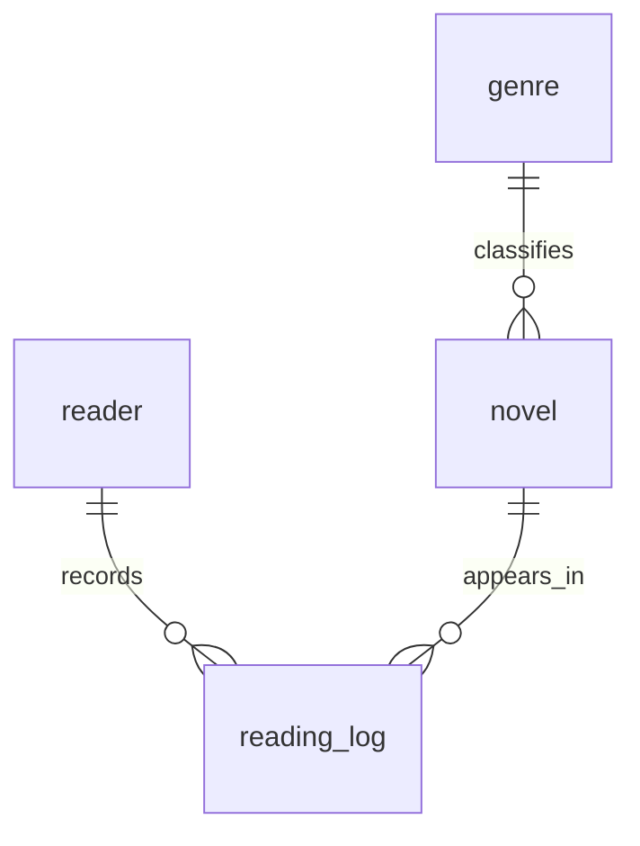

# 디지털 서랍장 — 웹소설 독서 기록 DB

장르·독자·작품·독서 기록을 관계형 데이터베이스로 정리하고 SQL로 검색·집계하는 학습 프로젝트입니다. 화면이나 API 없이 SQLite와 SQL만 사용합니다. Python은 SQL 실행과 텍스트 증빙 저장을 돕는 도구이며 백엔드 프레임워크는 사용하지 않습니다.

## 1. 과제 정보 및 범위

- 분야: AI/SW 기초 / 데이터베이스와 백엔드
- 과제: 정보를 깔끔하게 정리하는 디지털 서랍장 만들기
- 학습시간: 교육과정 기준 40시간(실제 수행시간을 증명하는 의미가 아닙니다)
- DB: 로컬 SQLite / 실행 도구: Python 표준 sqlite3 기반 CLI
- 데이터: 모두 가상 인물·가상 작품으로 구성된 학습용 데이터
- 제외: Spring·Django·Express, ORM, View, 프로시저, 트리거

## 2. 빠른 시작 — Windows / VS Code

1. ZIP 압축을 해제합니다.
2. VS Code에서 `digital-drawer` 폴더를 엽니다. `README.md`와 `run.py`가 보이는 폴더입니다.
3. 상단 **터미널 → 새 터미널**을 엽니다.
4. Python 설치 여부를 확인하고 실행합니다.

```powershell
py --version
py run.py
```

Python 3.10 이상이 필요합니다. `py`가 없는 환경에서는 `python --version`, `python run.py`를 사용합니다. macOS/Linux는 `python3 run.py`도 가능합니다. 외부 패키지 설치나 별도 DB 서버는 필요 없습니다.

성공하면 `data/drawer.db`가 생성되고 `results/q01.txt`부터 `q15.txt`, `validation.txt`가 생성됩니다. 결과 텍스트는 UTF-8이며 VS Code로 열면 됩니다. ZIP에는 검증 환경에서 실제 생성한 결과가 이미 들어 있습니다. 자신의 컴퓨터에서 실행하면 결과를 다시 생성합니다.

기존 DB를 실수로 지우지 않도록 같은 파일에는 재실행하지 않습니다. 다시 실습하려면 새 경로를 지정합니다.

```powershell
py run.py --db data/practice2.db
```

`results`는 가장 최근 실행 결과로 갱신됩니다. 중간 실행 오류가 발생한 경우 새 DB 경로로 다시 실행하세요.

## 3. 파일 구성

| 경로 | 역할 |
|---|---|
| `sql/01_schema.sql` | 4개 테이블, PK/FK/제약조건 생성 |
| `sql/02_seed.sql` | 부모 → 자식 순서 샘플 INSERT |
| `sql/03_queries.sql` | 설명을 붙인 핵심 SQL 정확히 15개 |
| `run.py` | DB 생성, SQL 실행, 증빙 저장, 무결성 검증 |
| `results/q01.txt` ~ `q15.txt` | 실제 쿼리 및 실행 결과 |
| `results/validation.txt` | 행 수, 제약조건 오류, 무결성 검증 결과 |
| `data/drawer.db` | 실행 시 생성되는 SQLite DB(Git 제외) |
| `.gitignore` | 생성 DB·캐시 제외 |

## 4. 데이터 모델



| 테이블 | PK | 주요 컬럼 | FK | 초기 행 수 |
|---|---|---|---|---|
| genre | genre_id | name(고유 장르명) | 없음 | 10 |
| reader | reader_id | nickname, email(각각 고유) | 없음 | 10 |
| novel | novel_id | title, author, total_episodes | genre_id → genre | 12 |
| reading_log | log_id | read_on, episodes_read, minutes_spent, rating, note | reader_id → reader / novel_id → novel | 30 |

1:N 관계는 장르→작품, 독자→독서 기록, 작품→독서 기록으로 총 3개입니다. 작품 하나는 대표 장르 하나만 가집니다. 작품의 제목과 작가 조합은 중복될 수 없습니다.

독서 기록 한 행은 **한 독자가 한 작품을 특정 날짜에 읽은 세션**입니다. `episodes_read`는 그 세션에서 읽은 회차 수이며 누적 진도가 아닙니다. 재독도 독서량에 포함합니다. `rating`은 세션별 선택 평가(1~5점 또는 NULL)입니다. 따라서 Q10 평균은 독자별 최종 작품 평점이 아니라 세션별 평가 평균입니다. Q14 실행 후에는 기록이 29행 남아 모든 테이블이 10행 이상을 유지합니다.

### 타입과 무결성

- INTEGER: 식별자, 회차 수, 시간(분), 평점.
- TEXT: 이름, 이메일, 메모, ISO 날짜(`YYYY-MM-DD`).
- PK: 행을 구분하는 기본 키. `INTEGER PRIMARY KEY`는 SQLite rowid와 연결됩니다.
- FK: 다른 테이블에 존재하는 키만 참조하게 합니다.
- NOT NULL: 필수 값 누락 차단.
- UNIQUE: 장르명·독자 닉네임·이메일 및 제목/작가 조합 중복 차단.
- CHECK: 양수 회차/시간 및 1~5점 평점 범위 검사.
- ON DELETE RESTRICT: 참조 중인 부모 행 삭제 차단.

SQLite FK 검사는 **접속할 때마다** `PRAGMA foreign_keys = ON;`으로 활성화합니다. 트랜잭션 밖에서 설정해야 합니다. 날짜 CHECK는 문자열 모양만 검사하며 윤년 등 달력 유효성까지 검사하지 않습니다. 이메일 역시 고유성만 검사합니다.

## 5. 핵심 쿼리와 요구사항 대응

| 번호 | 확인 내용 | 범주 |
|---|---|---|
| Q01 | 4점 이상 기록 | WHERE 기본 조회 |
| Q02 | 회차 수 TOP 5 | ORDER BY, LIMIT 기본 조회 |
| Q03 | 제목 키워드 검색 | LIKE 기본 조회 |
| Q04 | 10월 독서 기록 | 날짜 범위 기본 조회 |
| Q05 | 작품별 장르 | INNER JOIN |
| Q06 | 독자·작품·독서 기록 연결 | INNER JOIN |
| Q07 | 기록 없는 독자 포함 기록 수 | LEFT JOIN, GROUP BY, COUNT |
| Q08 | 기록이 없는 작품 | LEFT JOIN |
| Q09 | 독자별 총 회차와 시간 | GROUP BY, COUNT, SUM |
| Q10 | 작품별 세션 평균 평점 | GROUP BY, COUNT, AVG |
| Q11 | 월별 독서량 | GROUP BY, COUNT, SUM |
| Q12 | 기록 없는 작품(Q08 비교) | NOT EXISTS 서브쿼리 |
| Q13 | 1번 메모 수정 | UPDATE |
| Q14 | 30번 기록 삭제 | DELETE |
| Q15 | 날짜 조회 인덱스 생성 | CREATE INDEX |

기본 조회 4개, 조인 4개(INNER 2개 / LEFT 2개), 독립 집계 3개, 서브쿼리 1개, 수정·삭제 2개, 인덱스 1개로 총 15개입니다. 집계가 포함된 조인 Q07은 조인으로 계산했습니다.

Q13/Q14 결과에는 변경 전후 행과 영향받은 행 수가 있습니다. Q15에는 생성된 인덱스와 SQLite `EXPLAIN QUERY PLAN` 결과가 있습니다. 작은 데이터에서 실제 속도 개선을 측정했다는 의미는 아닙니다. 인덱스는 읽기를 도울 수 있지만 저장 공간과 쓰기 비용이 증가합니다. 날짜 범위 검색이 반복되는 `read_on`을 인덱스로 선택했습니다.

## 6. Python 없이 SQL 도구로 실행하기

SQLite를 지원하는 SQL 클라이언트 또는 SQLite CLI로 새 DB를 열고 다음 순서로 **파일 전체**를 실행합니다.

1. `sql/01_schema.sql`
2. `sql/02_seed.sql`
3. `sql/03_queries.sql`

SQLite CLI가 별도로 설치되어 있다면 프로젝트 폴더에서 다음을 사용합니다. `.read`는 SQL이 아니라 SQLite CLI 전용 명령입니다.

```text
sqlite3 manual.db
.read sql/01_schema.sql
.read sql/02_seed.sql
.headers on
.mode column
.read sql/03_queries.sql
.quit
```

각 파일의 `PRAGMA`도 함께 실행해야 FK 검사가 켜집니다. 스키마는 기존 테이블을 삭제하지 않으며 새 DB를 전제로 합니다. 쿼리는 순서대로 실행합니다. Q13/Q14는 실제 변경을 저장하므로 재실행하면 DELETE 영향 행 수가 달라집니다. 동일 증빙을 재현하려면 새 DB에서 시작합니다. 수동 실행 시 결과 텍스트나 스크린샷을 직접 저장해야 하며 자동 결과 폴더 생성은 `run.py`가 담당합니다.

SQLite 전용 요소는 `PRAGMA`, `GLOB`, `INTEGER PRIMARY KEY`의 rowid 동작 및 실행계획 확인입니다. `LIMIT`도 DB마다 문법 차이가 있을 수 있습니다. MySQL/PostgreSQL에 그대로 실행하는 프로젝트가 아닙니다.

## 7. 보너스 실습

### 같은 요구를 JOIN과 서브쿼리로 해결

Q08은 LEFT JOIN 결과에서 기록 키가 NULL인 작품을 고르고 Q12는 NOT EXISTS로 연결 기록이 없는 작품을 고릅니다. 샘플에서는 두 방식 모두 11번과 12번 작품을 반환하며 실행 도구가 결과 일치를 검사합니다. JOIN은 다른 테이블 컬럼까지 함께 출력할 때 편하고 EXISTS는 존재 여부만 확인할 때 의도가 분명합니다. 성능은 DB·데이터·인덱스에 따라 달라집니다.

### FK 오류 재현

```sql
PRAGMA foreign_keys = ON;
INSERT INTO novel VALUES (99, 999, '없는 장르', '테스트', 10);
```

장르 999가 없어 `FOREIGN KEY constraint failed`가 발생합니다. 기존 장르 ID를 사용하거나 실제로 필요한 새 장르를 먼저 INSERT하면 해결됩니다. FK 검사를 끄는 것은 해결책이 아닙니다. 실행 도구는 이 오류와 UNIQUE·NOT NULL·CHECK·부모 삭제 제한을 실제로 발생시킨 후 SAVEPOINT로 되돌립니다. 자세한 SQL과 실제 오류는 `results/validation.txt`에 있습니다.

### 미니 리포트: 핵심 지표 3개

| 지표 | 정의 | 최종 SQL 위치 | 해석 주의 |
|---|---|---|---|
| 독자별 독서량 | 세션별 읽은 회차 합계 | Q09 | 재독 포함, 완독률 아님 |
| 작품별 평균 평점 | NULL 제외 세션 평점 평균 | Q10 | 독자마다 여러 평가 가능 |
| 월별 독서량 | 기록 날짜 연월별 회차 합계 | Q11 | 누적 진도와 구분 |

세 지표의 실행 결과는 각각 q09.txt, q10.txt, q11.txt입니다. Q14 삭제 전의 순차 실행 시점 결과입니다.

## 8. 학습 설명

엑셀에서도 표를 연결할 수 있지만 이 과제의 관계형 DB는 PK/FK와 제약조건으로 연결 규칙을 DB 자체가 강제합니다. 장르명과 독자 정보를 기록마다 반복 저장하지 않고 별도 테이블로 분리하여 중복과 수정 불일치를 줄입니다. JOIN은 이 정보를 연결해 보여주고 GROUP BY는 독자·작품·월처럼 같은 기준끼리 묶어 집계합니다.

INSERT는 새 행 추가, SELECT는 조회, UPDATE는 기존 행 수정, DELETE는 행 삭제입니다. UPDATE와 DELETE에서 WHERE를 빠뜨리면 전체 행이 대상이 될 수 있습니다. 이번 SQL에는 특정 log_id 조건을 사용했습니다.

## 9. 검증 및 제출

`py run.py`는 초기/최종 행 수, FK 활성화, JOIN/서브쿼리 결과 일치, UPDATE/DELETE 결과, 다섯 종류의 제약조건, FK 무결성 및 DB integrity check를 검증합니다. 이 ZIP의 결과 폴더는 생성 환경에서 실제 실행해 만든 자료이며 사용자 PC의 실행 증빙이라고 주장하지 않습니다.

제출 대상은 README, sql 폴더, results 폴더이며 재현을 위해 run.py와 .gitignore도 함께 제출합니다. 실제 과제 제출 전에 직접 실행하고 위 모델과 쿼리를 설명할 수 있는지 확인하세요.

새 GitHub 저장소 예시 이름: `digital-drawer-sql`

Description 예시: `SQLite 기반 웹소설 독서 기록 DB — 테이블 설계, SQL 15개, 무결성 검증 및 실행 결과`

새로 만든 빈 GitHub 저장소에 업로드할 경우 프로젝트 폴더에서 실행합니다. 아래 URL은 자신의 실제 저장소 URL로 바꾸세요. 이미 Git 저장소 안이라면 새 git init을 하기 전에 현재 위치와 원격 저장소를 확인하세요.

```bash
git init
git add .
git commit -m "Complete SQLite digital drawer project"
git branch -M main
git remote add origin https://github.com/YOUR_ID/digital-drawer-sql.git
git push -u origin main
```

기존 ai-gitgen 저장소를 수정할 필요 없이 별도 과제로 관리할 수 있습니다. 저장소 생성과 GitHub 인증은 별도로 진행해야 합니다.
