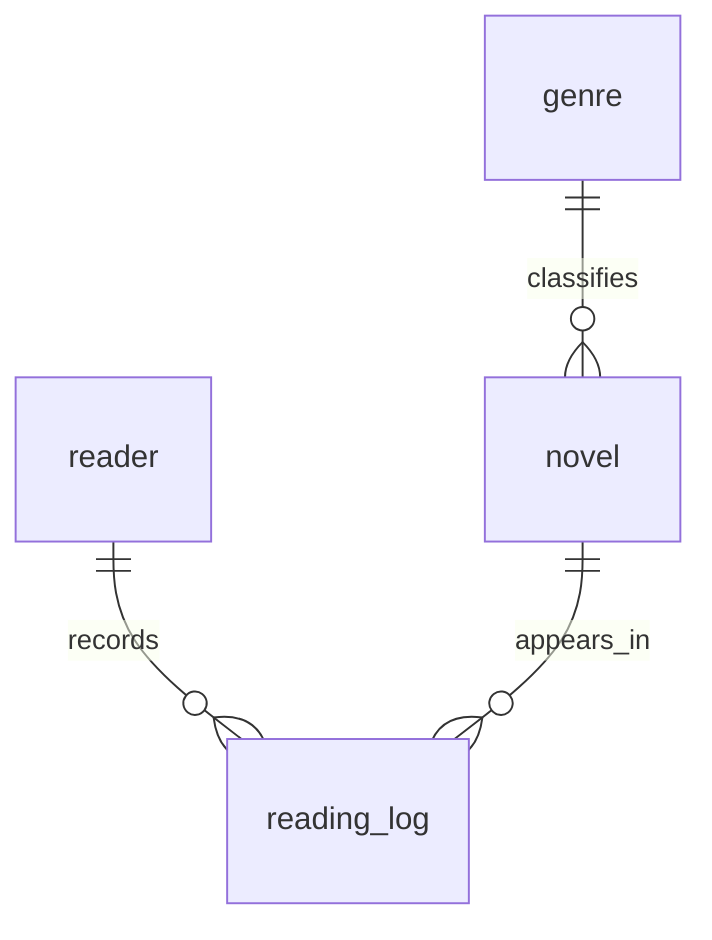

# 디지털 서랍장 — 웹소설 독서 기록 DB

웹소설의 장르·독자·작품·독서 기록을 관계형 데이터베이스로 관리하고, SQL로 검색·집계하는 학습 프로젝트입니다.

테이블 설계부터 샘플 데이터 입력, SQL 실행, 무결성 검증까지 구현했습니다. 웹 화면이나 API는 만들지 않았으며, Python은 SQL 실행과 결과 저장을 자동화하는 도구로 사용했습니다.

- 저장소: https://github.com/Leesongha12/digital-drawer-sql
- 제출 브랜치: `main`
- 데이터베이스: SQLite
- 실행 환경: Python 3.10 이상
- 외부 패키지 및 백엔드 프레임워크: 사용하지 않음
- 데이터: 가상 인물·가상 작품으로 구성한 학습용 데이터

---

## 1. 과제 개요

| 항목 | 내용 |
|---|---|
| 분야 | AI/SW 기초 |
| 구분 | 데이터베이스와 백엔드 |
| 과제명 | 정보를 깔끔하게 정리하는 디지털 서랍장 만들기 |
| 교육과정 배정 시간 | 40시간 |
| 프로젝트 주제 | 웹소설 독서 기록 관리 |
| 핵심 학습 내용 | 테이블 설계, PK/FK, 1:N 관계, 제약조건, SQL 조회·집계·수정·삭제, 인덱스 |

교육과정 배정 시간은 실제 작업시간을 기록한 값은 아닙니다.

### 구현 목표

1. 데이터를 역할에 따라 나누어 저장합니다.
2. PK와 FK로 테이블을 연결합니다.
3. 제약조건으로 잘못된 데이터 입력을 차단합니다.
4. SQL로 검색·정렬·통계·수정·삭제를 수행합니다.
5. 실제 실행 결과와 검증 기록을 남깁니다.

### 기술별 역할

| 기술 | 역할 |
|---|---|
| SQLite | 데이터를 저장하고 SQL을 처리하는 DB 엔진 |
| SQL | 테이블 생성, 데이터 입력·조회·수정·삭제 |
| Python | SQL 파일 실행, 결과 저장, 검증 자동화 |
| Git/GitHub | 코드와 실행 결과의 버전 관리 |

Spring·Django·Express 등의 백엔드 프레임워크, ORM, View, 프로시저, 트리거는 사용하지 않았습니다.

---

## 2. 실행 방법

### 2.1 프로젝트 열기

프로젝트를 다운로드하거나 복제한 후, VS Code에서 `README.md`와 `run.py`가 있는 폴더를 엽니다.

상단 메뉴에서 **터미널 → 새 터미널**을 선택합니다.

### 2.2 Python 확인 및 실행

```powershell
py --version
py run.py
```

`py` 명령을 사용할 수 없는 환경에서는 다음과 같이 실행합니다.

```powershell
python --version
python run.py
```

macOS/Linux에서는 `python3 run.py`를 사용할 수 있습니다.

Python 표준 라이브러리만 사용하므로 별도의 `pip install`이나 DB 서버 실행은 필요하지 않습니다.

### 2.3 실행 결과

정상 실행되면 다음 작업이 진행됩니다.

1. SQLite DB 파일 생성
2. 테이블 4개 생성
3. 샘플 데이터 입력
4. 핵심 SQL 15개 실행
5. 실행 결과 텍스트 저장
6. 데이터 및 제약조건 검증

생성되는 주요 파일은 다음과 같습니다.

| 경로 | 내용 |
|---|---|
| `data/drawer.db` | 실제 SQLite 데이터베이스 |
| `results/q01.txt` ~ `q15.txt` | 쿼리별 실행 결과 |
| `results/validation.txt` | 데이터 수 및 제약조건 검증 결과 |

결과 파일은 UTF-8 텍스트이며 VS Code로 열어 확인할 수 있습니다.

### 2.4 다시 실행하기

기존 DB를 덮어쓰지 않도록, 같은 DB 경로가 이미 존재하면 실행을 중단합니다.

새 DB 이름을 지정하면 다시 실습할 수 있습니다.

```powershell
py run.py --db data/practice2.db
```

`--db`는 생성할 DB 경로를 지정하는 옵션입니다.

DB 이름을 변경해도 결과 파일은 같은 `results` 폴더에 저장됩니다. 성공적으로 다시 실행하면 해당 실행 결과로 갱신됩니다.

중간 오류로 일부만 생성된 DB가 남은 경우에도 새 DB 경로로 실행합니다.

---

## 3. 파일 구성

| 경로 | 역할 |
|---|---|
| `README.md` | 프로젝트 설명, 코드 해설, 평가문항 대응 |
| `sql/01_schema.sql` | 테이블·PK·FK·제약조건 생성 |
| `sql/02_seed.sql` | 샘플 데이터 INSERT |
| `sql/03_queries.sql` | 핵심 SQL 15개 |
| `run.py` | SQL 실행, 결과 저장, 검증 |
| `results/q01.txt` ~ `q15.txt` | 각 SQL과 실제 실행 결과 |
| `results/validation.txt` | 무결성 및 제약조건 검증 결과 |
| `data/drawer.db` | 실행 시 생성되는 DB 파일 |
| `.gitignore` | 생성 DB와 Python 캐시 등을 Git에서 제외 |

스키마, 샘플 데이터, 활용 쿼리를 분리하여 각 파일의 목적을 명확하게 했습니다.

DB 파일은 SQL로 다시 생성할 수 있으므로 Git에서 제외하고, 재현에 필요한 코드와 실행 결과를 관리합니다.

---

## 4. 데이터 모델과 테이블 분리 이유

### 4.1 테이블 구성

| 테이블 | 역할 | PK | FK | 초기 행 수 |
|---|---|---|---|---:|
| `genre` | 장르 정보 | `genre_id` | 없음 | 10 |
| `reader` | 독자 정보 | `reader_id` | 없음 | 10 |
| `novel` | 작품 정보 | `novel_id` | `genre_id` | 12 |
| `reading_log` | 독서 활동 기록 | `log_id` | `reader_id`, `novel_id` | 30 |

Q14에서 독서 기록 1행을 삭제한 후에도 독서 기록은 29행이므로, 모든 테이블이 최소 10행 이상을 유지합니다.

### 4.2 ERD



### 4.3 테이블을 나눈 이유

독서 기록마다 장르명, 독자 이메일, 작품 제목을 반복 저장하면 같은 정보가 여러 행에 중복됩니다.

예를 들어 독자 이메일이 변경되었을 때 일부 기록만 수정하면 같은 독자의 이메일이 서로 다르게 남을 수 있습니다.

이 프로젝트에서는 다음과 같이 분리했습니다.

- 장르명은 `genre`에서 관리합니다.
- 닉네임과 이메일은 `reader`에서 관리합니다.
- 제목·작가·전체 회차 수는 `novel`에서 관리합니다.
- 독서 활동은 `reading_log`에 저장하고 독자·작품 번호를 참조합니다.

따라서 독자 이메일이 바뀌면 `reader`의 해당 행만 수정하면 됩니다.

### 4.4 PK와 FK

**PK: Primary Key, 기본 키**

테이블 안에서 각 행을 식별하는 값입니다.

예를 들어 `novel.novel_id = 1`은 1번 작품을 구분합니다.

**FK: Foreign Key, 외래 키**

다른 테이블의 키를 참조하는 값입니다.

예를 들어 `reading_log.novel_id = 1`은 해당 독서 기록이 1번 작품에 관한 기록이라는 의미입니다.

### 4.5 실제 데이터로 설명하는 1:N 관계

1:N은 하나의 데이터에 여러 데이터가 연결될 수 있는 관계입니다.

| 관계 | 실제 샘플 예시 |
|---|---|
| 장르 1개 → 작품 여러 개 | 장르 1번 ‘로맨스판타지’에 작품 1번과 11번이 연결 |
| 독자 1명 → 독서 기록 여러 개 | 독자 1번에 기록 1·9·17·25번이 연결 |
| 작품 1개 → 독서 기록 여러 개 | 작품 1번에 기록 1·11·21번이 연결 |

총 3개의 1:N 관계를 구성했습니다.

이번 모델에서는 작품 하나가 대표 장르 하나만 가집니다.

### 4.6 독서 기록 한 행의 의미

독서 기록 한 행은 **한 독자가 한 작품을 특정 날짜에 읽은 활동 한 번**입니다.

- `episodes_read`: 그 활동에서 읽은 회차 수
- `minutes_spent`: 독서에 사용한 시간, 단위는 분
- `rating`: 해당 독서 활동에 남긴 선택 평점
- `note`: 독서 메모

`episodes_read = 5`는 그 활동에서 5회차 분량을 읽었다는 뜻입니다. 현재 5화까지 읽었다는 누적 진도가 아닙니다.

재독도 읽은 분량에 포함됩니다. 평점 역시 독자별 최종 평가가 아니라 독서 활동별 평가이므로 한 독자가 여러 번 평가할 수 있습니다.

---

## 5. 컬럼 타입과 제약조건

### 5.1 타입 선택 이유

| 컬럼 | 타입 | 선택 이유 |
|---|---|---|
| 각 테이블의 ID | INTEGER | 행 식별과 참조에 정수 번호 사용 |
| 전체 회차 수·읽은 회차 수 | INTEGER | 회차 수를 정수로 기록 |
| 독서 시간 | INTEGER | 정수 분 단위로 기록 |
| 평점 | INTEGER | 1~5점 정수 척도 사용 |
| 이름·제목·이메일·메모 | TEXT | 길이가 달라질 수 있는 문자열 |
| 독서 날짜 | TEXT | `YYYY-MM-DD` 형식으로 저장 |

SQLite에는 별도의 날짜 저장 클래스가 없으므로 날짜를 ISO 형식의 문자열로 저장했습니다.

같은 형식을 유지하면 문자열 비교로 날짜 범위를 조회하고 정렬할 수 있습니다.

SQLite의 일반 테이블은 유연한 타입 체계를 사용하므로, 타입 선언만으로 모든 잘못된 입력을 차단한다고 보지는 않습니다.

### 5.2 적용한 제약조건

| 제약조건 | 적용 목적 |
|---|---|
| `PRIMARY KEY` | 행 식별 |
| `FOREIGN KEY` | 존재하는 부모 데이터만 참조 |
| `NOT NULL` | 필수 값의 NULL 누락 차단 |
| `UNIQUE` | 중복 값 제한 |
| `CHECK` | 값의 범위·조건 검사 |
| `ON DELETE RESTRICT` | 참조 중인 부모 데이터 삭제 차단 |

`NOT NULL`은 NULL을 막지만 빈 문자열까지 막는 조건은 아닙니다.

### 5.3 검증 범위와 한계

- 평점은 1~5 범위로 제한하며, 미평가는 NULL로 허용합니다.
- 읽은 회차 수와 독서 시간은 양수로 제한합니다.
- 날짜는 길이와 문자열 모양을 검사합니다.
- 날짜의 윤년·월별 일수 등 실제 달력 유효성은 검사하지 않습니다.
- 이메일은 필수 값과 중복 여부를 검사하지만 완전한 이메일 형식 검증은 하지 않습니다.

---

## 6. 스키마 생성 코드 설명

파일: [`sql/01_schema.sql`](sql/01_schema.sql)

### 6.1 외래 키 검사와 트랜잭션

```sql
PRAGMA foreign_keys = ON;
BEGIN;
```

`PRAGMA foreign_keys = ON`은 SQLite의 외래 키 검사를 활성화합니다.

외래 키는 선언만 하는 것이 아니라 실제 검사가 켜져 있어야 하므로, 접속마다 트랜잭션 시작 전에 설정합니다.

`BEGIN`은 트랜잭션을 시작하고, 파일 마지막의 `COMMIT`은 변경을 확정합니다.

### 6.2 장르 테이블

```sql
CREATE TABLE genre (
    genre_id INTEGER PRIMARY KEY,
    name TEXT NOT NULL UNIQUE
);
```

- `genre_id`: 장르를 식별하는 기본 키입니다.
- `name`: 장르명입니다.
- `NOT NULL`: 장르명이 누락되는 것을 막습니다.
- `UNIQUE`: 같은 장르명의 중복 등록을 막습니다.

SQLite의 `INTEGER PRIMARY KEY`는 내부 행 식별자인 `rowid`의 별칭으로 동작합니다.

### 6.3 독자 테이블

```sql
CREATE TABLE reader (
    reader_id INTEGER PRIMARY KEY,
    nickname TEXT NOT NULL UNIQUE,
    email TEXT NOT NULL UNIQUE
);
```

독자 번호, 닉네임, 이메일을 저장합니다.

닉네임과 이메일은 각각 중복을 제한합니다. 이는 이번 학습 프로젝트에서 정한 규칙입니다.

### 6.4 작품 테이블

```sql
CREATE TABLE novel (
    novel_id INTEGER PRIMARY KEY,
    genre_id INTEGER NOT NULL
        REFERENCES genre(genre_id) ON DELETE RESTRICT,
    title TEXT NOT NULL,
    author TEXT NOT NULL,
    total_episodes INTEGER NOT NULL CHECK(total_episodes > 0),
    UNIQUE(title, author)
);
```

| 코드 | 설명 |
|---|---|
| `novel_id INTEGER PRIMARY KEY` | 작품 고유 번호 |
| `REFERENCES genre(genre_id)` | 존재하는 장르만 참조 |
| `ON DELETE RESTRICT` | 작품이 참조 중인 장르 삭제 차단 |
| `CHECK(total_episodes > 0)` | 전체 회차 수를 양수로 제한 |
| `UNIQUE(title, author)` | 제목과 작가 조합의 중복 제한 |

제목만 같고 작가가 다른 작품은 허용합니다.

### 6.5 독서 기록 테이블

```sql
CREATE TABLE reading_log (
    log_id INTEGER PRIMARY KEY,
    reader_id INTEGER NOT NULL
        REFERENCES reader(reader_id) ON DELETE RESTRICT,
    novel_id INTEGER NOT NULL
        REFERENCES novel(novel_id) ON DELETE RESTRICT,
    read_on TEXT NOT NULL
        CHECK(
            length(read_on)=10
            AND read_on GLOB
                '[0-9][0-9][0-9][0-9]-[0-9][0-9]-[0-9][0-9]'
        ),
    episodes_read INTEGER NOT NULL CHECK(episodes_read > 0),
    minutes_spent INTEGER NOT NULL CHECK(minutes_spent > 0),
    rating INTEGER CHECK(rating BETWEEN 1 AND 5),
    note TEXT NOT NULL DEFAULT ''
);
```

- 독자와 작품을 각각 외래 키로 연결합니다.
- 날짜는 10글자의 `YYYY-MM-DD` 모양인지 검사합니다.
- `GLOB`은 SQLite에서 사용하는 문자열 패턴 비교 문법입니다.
- 읽은 회차 수와 독서 시간은 양수여야 합니다.
- 평점은 필수가 아니므로 NULL을 허용합니다.
- 메모를 생략하면 기본값인 빈 문자열을 저장합니다.

동일 독자가 같은 작품을 여러 번 읽을 수 있으므로 독자·작품 조합에는 UNIQUE를 적용하지 않았습니다.

---

## 7. 샘플 데이터 입력 코드 설명

파일: [`sql/02_seed.sql`](sql/02_seed.sql)

### 7.1 입력 순서

1. 장르 입력
2. 독자 입력
3. 작품 입력
4. 독서 기록 입력

부모 데이터가 있어야 자식 데이터가 해당 키를 참조할 수 있기 때문입니다.

### 7.2 실제 입력 예시

```sql
INSERT INTO genre VALUES (1, '로맨스판타지');

INSERT INTO reader
VALUES (1, '독자01', 'reader01@example.com');

INSERT INTO novel
VALUES (1, 1, '달빛 상담소', '작가01', 70);

INSERT INTO reading_log
VALUES (
    1, 1, 1, '2026-09-01',
    2, 15, 2, '샘플 독서 기록'
);
```

`INSERT INTO`는 새 행을 추가합니다.

컬럼 목록을 생략했으므로 `VALUES`의 값은 테이블에 선언한 컬럼 순서에 맞게 전달합니다.

마지막 기록은 다음 뜻입니다.

| 항목 | 값 |
|---|---|
| 기록 번호 | 1 |
| 독자 번호 | 1 |
| 작품 번호 | 1 |
| 독서 날짜 | 2026-09-01 |
| 읽은 회차 수 | 2 |
| 독서 시간 | 15분 |
| 평점 | 2점 |
| 메모 | 샘플 독서 기록 |

### 7.3 검증을 위한 데이터 구성

단순히 행 수만 채우지 않고 다음 상황도 포함했습니다.

- 독자 9·10번: 독서 기록 없음
- 작품 11·12번: 독서 기록 없음
- 일부 독서 기록: 평점이 NULL
- 동일 독자: 여러 독서 기록 보유
- 동일 작품: 여러 독서 기록 보유

이 데이터를 통해 LEFT JOIN, 서브쿼리, 그룹 집계, NULL 처리를 확인합니다.

---

## 8. 핵심 SQL 15개와 코드 설명

파일: [`sql/03_queries.sql`](sql/03_queries.sql)

| 범주 | 개수 | 번호 |
|---|---:|---|
| 기본 조회 | 4 | Q01~Q04 |
| 조인 | 4 | Q05~Q08 |
| 집계 | 3 | Q09~Q11 |
| 서브쿼리 | 1 | Q12 |
| 수정·삭제 | 2 | Q13~Q14 |
| 인덱스 | 1 | Q15 |
| 합계 | 15 | Q01~Q15 |

Q07에도 집계가 있지만 개수 산정에서는 조인으로 분류했습니다.

결과는 새 DB에서 Q01부터 Q15까지 순서대로 실행한 시점 기준입니다. Q01~Q12의 결과는 Q14 삭제 전 데이터입니다.

### Q01. 평점 4점 이상인 독서 기록

```sql
SELECT log_id, reader_id, novel_id, rating
FROM reading_log
WHERE rating >= 4
ORDER BY log_id;
```

- `SELECT`: 출력할 컬럼을 선택합니다.
- `FROM`: 데이터를 가져올 테이블을 지정합니다.
- `WHERE`: 평점 4점 이상인 행만 선택합니다.
- `ORDER BY`: 기록 번호순으로 정렬합니다.

미평가 NULL은 `rating >= 4` 조건에 해당하지 않습니다.

결과: [`results/q01.txt`](results/q01.txt)

### Q02. 전체 회차 수가 많은 작품 TOP 5

```sql
SELECT novel_id, title, total_episodes
FROM novel
ORDER BY total_episodes DESC, novel_id
LIMIT 5;
```

- `DESC`: 큰 값부터 내림차순 정렬합니다.
- 회차 수가 같으면 작품 번호순으로 정렬합니다.
- `LIMIT 5`: 최대 5행만 반환합니다.

인기 순위가 아니라 전체 회차 수 기준 순위입니다.

결과: [`results/q02.txt`](results/q02.txt)

### Q03. 제목에 ‘마법’이 포함된 작품

```sql
SELECT novel_id, title, author
FROM novel
WHERE title LIKE '%마법%'
ORDER BY novel_id;
```

`LIKE`는 문자열 패턴으로 검색합니다.

`%`는 길이가 0 이상인 문자열을 의미하므로, `%마법%`은 제목 어디에든 ‘마법’이 포함된 작품을 찾습니다.

샘플에서는 ‘퇴근 후 마법사’가 조회됩니다.

결과: [`results/q03.txt`](results/q03.txt)

### Q04. 2026년 10월 독서 기록

```sql
SELECT log_id, read_on, episodes_read
FROM reading_log
WHERE read_on >= '2026-10-01'
  AND read_on < '2026-11-01'
ORDER BY read_on, log_id;
```

10월 1일 이상, 11월 1일 미만인 기록을 선택합니다.

날짜를 같은 ISO 형식으로 저장했으므로 문자열 범위 비교를 사용합니다.

날짜가 같으면 기록 번호로 순서를 정합니다.

결과: [`results/q04.txt`](results/q04.txt)

### Q05. 작품과 장르 연결

```sql
SELECT n.novel_id, n.title, g.name AS genre
FROM novel n
INNER JOIN genre g
    ON n.genre_id = g.genre_id
ORDER BY n.novel_id;
```

작품 테이블의 장르 번호와 장르 테이블의 번호를 연결하여 장르 이름을 가져옵니다.

- `n`, `g`: 테이블 이름을 짧게 쓰기 위한 별칭
- `ON`: 테이블을 연결하는 조건
- `AS genre`: 출력 컬럼 이름 지정
- `INNER JOIN`: 연결 조건에 맞는 행끼리 결합

이번 샘플은 모든 작품에 유효한 장르가 있으므로 모든 작품이 연결됩니다.

결과: [`results/q05.txt`](results/q05.txt)

### Q06. 독자·작품·독서 기록 상세 조회

```sql
SELECT
    l.log_id,
    r.nickname,
    n.title,
    l.read_on,
    l.episodes_read
FROM reading_log l
INNER JOIN reader r
    ON l.reader_id = r.reader_id
INNER JOIN novel n
    ON l.novel_id = n.novel_id
ORDER BY l.log_id;
```

독서 기록에 독자와 작품을 각각 연결합니다.

숫자 ID만 있는 기록을 사람이 읽기 쉬운 닉네임과 작품 제목이 포함된 기록으로 바꿉니다.

초기 상태에서는 독서 기록 30행이 조회됩니다.

결과: [`results/q06.txt`](results/q06.txt)

### Q07. 기록이 없는 독자까지 포함한 기록 수

```sql
SELECT
    r.reader_id,
    r.nickname,
    COUNT(l.log_id) AS log_count
FROM reader r
LEFT JOIN reading_log l
    ON r.reader_id = l.reader_id
GROUP BY r.reader_id, r.nickname
ORDER BY r.reader_id;
```

모든 독자를 출력하기 위해 `reader`를 왼쪽 테이블로 두고 LEFT JOIN을 사용합니다.

기록이 없는 독자는 연결된 독서 기록 컬럼이 NULL인 상태로 남습니다.

`GROUP BY`로 독자별 그룹을 만들고 `COUNT(l.log_id)`로 실제 기록 수를 계산합니다.

**COUNT(*)를 사용하지 않은 이유**

- `COUNT(*)`는 LEFT JOIN 결과의 빈 연결 행도 셉니다.
- `COUNT(l.log_id)`는 NULL을 제외하고 실제 기록 번호만 셉니다.
- 따라서 기록이 없는 독자 9·10번은 0건으로 집계됩니다.

결과: [`results/q07.txt`](results/q07.txt)

### Q08. 독서 기록이 없는 작품

```sql
SELECT n.novel_id, n.title
FROM novel n
LEFT JOIN reading_log l
    ON n.novel_id = l.novel_id
WHERE l.log_id IS NULL
ORDER BY n.novel_id;
```

모든 작품에 독서 기록을 연결한 뒤, 연결된 기록이 없는 작품만 선택합니다.

`log_id`는 기본 키이므로 실제 기록에서는 NULL이 아닙니다. 조인 결과에서 NULL이면 연결된 기록이 없다는 뜻입니다.

샘플 결과는 다음 두 작품입니다.

- 11번: 겨울 정원의 계약
- 12번: 새벽의 연금술사

결과: [`results/q08.txt`](results/q08.txt)

### Q09. 독자별 총 독서량과 시간

```sql
SELECT
    reader_id,
    COUNT(*) AS sessions,
    SUM(episodes_read) AS episodes,
    SUM(minutes_spent) AS minutes
FROM reading_log
GROUP BY reader_id
ORDER BY episodes DESC, reader_id;
```

같은 독자의 기록을 하나의 그룹으로 묶습니다.

| 함수 | 계산 내용 |
|---|---|
| `COUNT(*)` | 독서 활동 횟수 |
| `SUM(episodes_read)` | 읽은 회차 수 합계 |
| `SUM(minutes_spent)` | 독서 시간 합계 |

독자 3번은 4회, 22회차, 100분으로 집계됩니다.

독서 기록 테이블에서 시작하므로 기록이 없는 독자는 출력되지 않습니다.

결과: [`results/q09.txt`](results/q09.txt)

### Q10. 작품별 평균 평점

```sql
SELECT
    novel_id,
    COUNT(rating) AS rating_count,
    ROUND(AVG(rating), 2) AS avg_rating
FROM reading_log
GROUP BY novel_id
ORDER BY avg_rating DESC, novel_id;
```

- `COUNT(rating)`: NULL을 제외한 평가 수
- `AVG(rating)`: NULL을 제외한 평균 평점
- `ROUND(..., 2)`: 소수점 둘째 자리까지 반올림

작품 4번의 평점은 `5, 5, NULL`이므로 평가 수는 2개이고 평균은 5점입니다.

미평가를 0점으로 처리하지 않습니다.

평점은 독서 기록별 평가이므로 독자별 최종 평점 평균과는 다릅니다.

결과: [`results/q10.txt`](results/q10.txt)

### Q11. 월별 독서량

```sql
SELECT
    SUBSTR(read_on, 1, 7) AS month,
    COUNT(*) AS sessions,
    SUM(episodes_read) AS episodes
FROM reading_log
GROUP BY SUBSTR(read_on, 1, 7)
ORDER BY month;
```

`SUBSTR(read_on, 1, 7)`은 날짜의 첫 글자부터 7글자를 추출합니다.

예를 들어 `2026-10-01`에서 `2026-10`을 가져옵니다.

연월별로 그룹을 만들고 독서 횟수와 회차 수를 합산합니다.

| 월 | 독서 횟수 | 읽은 회차 수 |
|---|---:|---:|
| 2026-09 | 15 | 58 |
| 2026-10 | 15 | 59 |

위 결과는 Q14 삭제 전 기준입니다.

결과: [`results/q11.txt`](results/q11.txt)

### Q12. 서브쿼리로 독서 기록 없는 작품 찾기

```sql
SELECT n.novel_id, n.title
FROM novel n
WHERE NOT EXISTS (
    SELECT 1
    FROM reading_log l
    WHERE l.novel_id = n.novel_id
)
ORDER BY n.novel_id;
```

각 작품에 대해 연결된 독서 기록이 있는지 내부 쿼리로 확인합니다.

`NOT EXISTS`는 조건에 맞는 행이 하나도 없을 때 참입니다.

`SELECT 1`은 행의 존재 여부만 확인하기 위한 표현이며, 1번 기록을 찾는다는 뜻이 아닙니다.

Q08과 동일하게 작품 11·12번을 반환합니다.

결과: [`results/q12.txt`](results/q12.txt)

### Q13. 메모 수정

```sql
UPDATE reading_log
SET note = '다음 회차도 읽고 싶은 작품'
WHERE log_id = 1;
```

- `UPDATE`: 기존 행 수정
- `SET`: 변경할 컬럼과 값 지정
- `WHERE`: 수정 대상 제한

1번 기록의 메모만 수정합니다. 결과 파일에 수정 전후 내용과 영향받은 행 수를 남깁니다.

WHERE를 생략하면 모든 행이 수정 대상이 될 수 있습니다.

결과: [`results/q13.txt`](results/q13.txt)

### Q14. 잘못 입력했다고 가정한 기록 삭제

```sql
DELETE FROM reading_log
WHERE log_id = 30;
```

30번 기록만 삭제합니다.

결과 파일에는 삭제 전 1행, 삭제 후 0행을 기록합니다.

전체 독서 기록은 30행에서 29행으로 줄어듭니다.

결과: [`results/q14.txt`](results/q14.txt)

### Q15. 날짜 검색용 인덱스 생성

```sql
CREATE INDEX IF NOT EXISTS idx_reading_log_read_on
ON reading_log(read_on);
```

Q04처럼 날짜 범위로 검색하는 작업을 돕기 위해 `read_on`에 인덱스를 생성합니다.

- `CREATE INDEX`: 인덱스 생성
- `IF NOT EXISTS`: 같은 이름이 이미 있으면 중복 생성 방지
- `ON reading_log(read_on)`: 대상 테이블과 컬럼 지정

인덱스는 검색을 돕는 색인입니다. 읽기 성능에 도움이 될 수 있지만 저장 공간과 데이터 변경 시 유지 비용이 추가됩니다.

실행 도구는 다음과 같은 SQLite 실행계획도 기록합니다.

```sql
EXPLAIN QUERY PLAN
SELECT *
FROM reading_log
WHERE read_on >= '2026-10-01'
  AND read_on < '2026-11-01';
```

실행계획에서 날짜 인덱스를 사용하는 것을 확인했습니다. 실제 속도 개선 배수를 측정한 것은 아닙니다.

결과: [`results/q15.txt`](results/q15.txt)

---

## 9. INNER JOIN과 LEFT JOIN의 차이

INNER JOIN은 연결 조건을 만족하는 행을 반환합니다.

LEFT JOIN은 연결 대상이 없어도 왼쪽 테이블의 행을 유지합니다.

같은 요구에서 차이를 비교하기 위해 Q07의 JOIN 종류만 바꿔 볼 수 있습니다.

### INNER JOIN으로 독자별 기록 수 조회

```sql
SELECT
    r.reader_id,
    r.nickname,
    COUNT(l.log_id) AS log_count
FROM reader r
INNER JOIN reading_log l
    ON r.reader_id = l.reader_id
GROUP BY r.reader_id, r.nickname
ORDER BY r.reader_id;
```

### LEFT JOIN으로 독자별 기록 수 조회

Q07을 사용합니다.

### 초기 샘플 데이터 기준 결과 비교

| 독자 | INNER JOIN | LEFT JOIN |
|---|---:|---:|
| 독자01~독자06 | 각각 4건 | 각각 4건 |
| 독자07~독자08 | 각각 3건 | 각각 3건 |
| 독자09~독자10 | 출력되지 않음 | 각각 0건 |
| 총 결과 행 수 | 8행 | 10행 |

‘독서한 독자만’ 필요하면 INNER JOIN을, ‘독서하지 않은 독자까지’ 필요하면 LEFT JOIN을 사용할 수 있습니다.

이 비교는 초기 샘플 상태에서 실행한 결과입니다. Q14까지 실행한 DB에서는 독자06의 기록 수가 3건이 됩니다.

추가 비교 SQL은 설명용이며 핵심 15개 개수에는 포함하지 않습니다.

---

## 10. GROUP BY와 집계 함수의 계산 과정

### 10.1 독자별 합계

독자03의 기록은 다음과 같습니다.

| 기록 번호 | 읽은 회차 수 | 독서 시간 |
|---|---:|---:|
| 3 | 4 | 25분 |
| 11 | 5 | 35분 |
| 19 | 6 | 15분 |
| 27 | 7 | 25분 |
| 합계 | 22 | 100분 |

Q09는 다음 순서로 이해할 수 있습니다.

1. `GROUP BY reader_id`로 같은 독자의 기록을 묶습니다.
2. `COUNT(*)`로 기록 4개를 셉니다.
3. `SUM(episodes_read)`로 `4+5+6+7=22`를 계산합니다.
4. `SUM(minutes_spent)`로 `25+35+15+25=100`을 계산합니다.

### 10.2 평균 평점과 NULL

작품04의 평점은 다음과 같습니다.

```text
5, 5, NULL
```

따라서 다음과 같이 계산합니다.

```text
COUNT(rating) = 2
AVG(rating) = (5 + 5) / 2 = 5
```

NULL은 평가하지 않았다는 뜻이며 0점이 아닙니다.

모든 평점이 NULL인 그룹이 있다면 AVG 결과도 NULL입니다.

---

## 11. 복합 쿼리 Q07의 단계별 풀이

Q07은 JOIN, NULL 처리, 그룹화, 집계를 함께 사용하므로 대표적인 설명 대상으로 선택했습니다.

### 요구사항

독서 기록이 없는 사람까지 포함하여 모든 독자의 기록 수를 출력합니다.

### 풀이 과정

1. **기준 테이블 선택**
   - 모든 독자가 필요하므로 `reader`를 기준으로 합니다.

2. **연결 조건 지정**
   - `reader_id`가 같은 독서 기록을 연결합니다.

3. **LEFT JOIN 선택**
   - 기록이 없는 독자도 남겨야 하므로 LEFT JOIN을 사용합니다.

4. **독자별 그룹 구성**
   - `GROUP BY r.reader_id, r.nickname`으로 독자별로 묶습니다.

5. **실제 기록 수 계산**
   - `COUNT(l.log_id)`로 NULL이 아닌 기록 번호만 셉니다.

6. **결과 정렬**
   - 독자 번호순으로 정렬합니다.

7. **검증**
   - 독자 10명이 모두 출력되는지 확인합니다.
   - 독자09·독자10의 기록 수가 0인지 확인합니다.

위 순서는 쿼리를 이해하기 위한 논리적 설명이며, DB 엔진의 물리적 실행 순서와 같다는 의미는 아닙니다.

---

## 12. 기술적 주의점과 해결 방법

아래는 구현에서 다룬 기술적 문제와 해결 방법입니다.

개인적인 시행착오 경험을 대신 작성한 내용은 아니며, 발표에서는 직접 실행하며 확인한 내용을 바탕으로 설명합니다.

| 문제 | 원인 | 해결 방법 |
|---|---|---|
| 기록 없는 독자가 조회에서 빠짐 | INNER JOIN은 일치하는 행만 반환 | 전체 독자 집계에 LEFT JOIN 사용 |
| 기록 없는 독자가 1건으로 집계될 수 있음 | COUNT(*)가 빈 연결 행도 계산 | COUNT(l.log_id) 사용 |
| 없는 값을 참조하는 입력이 허용될 수 있음 | SQLite 외래 키 검사가 꺼진 연결 | PRAGMA 활성화 및 상태 확인 |
| 미평가가 평균을 낮추는 것으로 처리될 위험 | NULL을 0점으로 취급 | AVG(rating)으로 NULL 제외 |
| 재실행 시 기존 데이터 변경 위험 | 같은 DB 파일 재사용 | 기존 파일이면 중단, 새 경로 지정 |
| 삭제 후 집계 결과가 기존 증빙과 달라짐 | 증빙 생성 후 Q14 실행 | 결과 시점 명시, 새 DB로 재현 |

발표에서 어려웠던 부분을 설명할 때는 문제, 원인, 적용한 해결, 확인 결과 순서로 정리할 수 있습니다.

---

## 13. run.py 주요 코드 설명

`run.py`는 SQL 실행과 검증을 자동화하는 명령줄 도구입니다.

### 13.1 사용하는 모듈

```python
import argparse
import re
import sqlite3
from pathlib import Path
```

| 모듈 | 역할 |
|---|---|
| `argparse` | 명령줄 옵션 처리 |
| `re` | 쿼리 번호 주석을 기준으로 문자열 분리 |
| `sqlite3` | SQLite 연결 및 SQL 실행 |
| `Path` | 파일·폴더 경로 처리 |

모두 Python 표준 라이브러리입니다.

### 13.2 프로젝트 기준 경로

```python
ROOT = Path(__file__).resolve().parent
```

실행 파일인 `run.py`가 있는 폴더를 기준 경로로 지정합니다.

SQL 파일과 결과 폴더를 이 기준으로 찾습니다.

`--db`로 입력한 상대 경로는 명령을 실행한 현재 폴더 기준으로 해석하므로 프로젝트 폴더에서 실행하는 것을 권장합니다.

### 13.3 실행 옵션과 기존 DB 보호

```python
parser = argparse.ArgumentParser(description=__doc__)
parser.add_argument(
    '--db',
    default=str(ROOT / 'data' / 'drawer.db'),
    help='새로 만들 DB 경로; 기존 파일은 덮어쓰지 않습니다.'
)
args = parser.parse_args()

db = Path(args.db).resolve()

if db.exists():
    parser.error(
        'DB가 이미 있습니다. 기존 DB를 보존하려면 '
        '--db data/another.db 를 사용하세요.'
    )
```

기본 DB 경로를 지정하고 `--db` 옵션으로 변경할 수 있게 합니다.

DB 파일이 이미 있으면 중단하여 기존 데이터를 보호합니다.

### 13.4 DB 연결과 SQL 파일 실행

```python
con = sqlite3.connect(db)

for name in ('01_schema.sql', '02_seed.sql'):
    con.executescript(
        (ROOT / 'sql' / name).read_text(encoding='utf-8')
    )
```

- `connect`: DB 연결 및 새 파일 생성
- `read_text`: SQL 파일 읽기
- `executescript`: 여러 SQL 문장이 있는 스크립트 실행

스키마 생성 후 샘플 데이터를 넣습니다.

### 13.5 초기 상태 검사

```python
assert con.execute(
    'PRAGMA foreign_keys'
).fetchone()[0] == 1
```

외래 키 검사가 실제로 활성화되었는지 확인합니다.

```python
assert before == {
    'genre': 10,
    'reader': 10,
    'novel': 12,
    'reading_log': 30
}
```

샘플 데이터가 예상한 수만큼 입력되었는지 확인합니다.

`assert`는 조건이 거짓이면 오류를 발생시키는 검증문입니다.

Python의 `-O` 최적화 옵션은 assert를 비활성화하므로 검증할 때는 README의 일반 실행 명령을 사용합니다.

### 13.6 SQL 15개 구분

```python
parts = re.split(
    r'(?m)^-- Q(\d{2}): ',
    (ROOT / 'sql' / '03_queries.sql').read_text(
        encoding='utf-8'
    )
)
```

`-- Q01:`, `-- Q02:` 같은 주석을 경계로 쿼리를 구분합니다.

- `(?m)`: 여러 줄에서 각 줄의 시작을 인식
- `^`: 줄 시작
- `\d{2}`: 두 자리 숫자
- 괄호: 번호를 결과에 포함하도록 캡처

머리말 1개와 번호·본문 15쌍으로 나뉘어 목록 길이는 31이 됩니다.

현재 SQL 파일 형식에 맞춘 실행기이며 범용 SQL 파서는 아닙니다.

### 13.7 쿼리 실행과 결과 변환

```python
cur = con.execute(sql)
result = render(cur)
```

`execute`는 SQL을 실행하고 커서를 반환합니다.

커서는 실행 결과를 읽는 데 사용합니다. `render` 함수는 결과를 텍스트로 변환합니다.

```python
if cursor.description is None:
    return f"affected_rows: {cursor.rowcount}\n"

names = [col[0] for col in cursor.description]
rows = cursor.fetchall()
```

- 조회 결과가 있으면 컬럼 이름과 행을 가져옵니다.
- 조회 결과가 없는 수정·삭제는 영향받은 행 수를 기록합니다.
- `fetchall()`은 남아 있는 결과 행을 모두 가져옵니다.
- 결과의 `None`은 텍스트에서 `NULL`로 표시합니다.

인덱스 생성은 별도 성공 문구, 인덱스 목록, 실행계획을 기록합니다.

### 13.8 수정·삭제 전후 확인

```python
con.execute(
    'SELECT * FROM reading_log WHERE log_id=?',
    (key,)
)
```

Q13·Q14의 실행 전후에 대상 행을 조회합니다.

`?`는 값이 들어갈 자리이며, 실제 값은 별도 매개변수로 전달합니다.

`(key,)`는 원소가 하나인 튜플입니다.

이 방식으로 SQL 문자열에 값을 직접 이어 붙이지 않고 전달합니다.

### 13.9 결과 파일 저장

각 쿼리의 설명, SQL, 결과를 다음 파일에 저장합니다.

```text
results/q01.txt
...
results/q15.txt
```

Q13·Q14에는 `BEFORE`, `AFTER` 구간이 포함되어 변경 전후를 비교할 수 있습니다.

### 13.10 변경 확정과 연결 종료

```python
con.commit()
```

수정·삭제 등의 변경을 확정합니다.

```python
finally:
    con.close()
```

실행 성공 여부와 관계없이 연결을 정리합니다.

전체 작업이 하나의 트랜잭션인 것은 아니므로, 중간 실패 시 부분 생성된 DB가 남을 수 있습니다. 이 경우 새 DB 경로로 다시 실행합니다.

---

## 14. 무결성 및 제약조건 검증

결과: [`results/validation.txt`](results/validation.txt)

### 14.1 검증 항목

| 항목 | 확인 내용 |
|---|---|
| 초기 데이터 수 | 10·10·12·30행인지 |
| 최종 데이터 수 | 10·10·12·29행인지 |
| FK 활성화 | 외래 키 검사 상태가 1인지 |
| Q08 = Q12 | JOIN과 서브쿼리 결과가 같은지 |
| UPDATE | 1번 메모가 지정한 값으로 바뀌었는지 |
| DELETE | 30번 기록이 삭제되었는지 |
| FK | 없는 장르 참조가 차단되는지 |
| UNIQUE | 중복 장르명이 차단되는지 |
| NOT NULL | 필수 값 누락이 차단되는지 |
| CHECK | 0회차 입력이 차단되는지 |
| 삭제 제한 | 참조 중인 독자 삭제가 차단되는지 |
| foreign_key_check | FK 위반이 없는지 |
| integrity_check | DB 구조 무결성 검사 결과가 정상인지 |

### 14.2 오류를 일부러 발생시키는 이유

```sql
INSERT INTO novel
VALUES (99, 999, '없는 장르', '테스트', 10);
```

999번 장르가 없으므로 다음 오류가 발생해야 합니다.

```text
FOREIGN KEY constraint failed
```

이 테스트에서 오류는 실패가 아니라 잘못된 입력을 차단했다는 증거입니다.

해결하려면 실제 존재하는 장르 번호를 사용하거나 필요한 장르를 먼저 등록해야 합니다. FK 검사를 끄는 것은 데이터 문제의 해결책이 아닙니다.

### 14.3 검증 후 원상 복구

```python
con.execute('SAVEPOINT check_constraint')

try:
    con.execute(sql)
except sqlite3.IntegrityError as err:
    evidence.append(
        f'PASS {name}\nSQL: {sql}\n실제 오류: {err}'
    )
else:
    raise AssertionError(
        f'{name}: 잘못된 입력이 허용됨'
    )
finally:
    con.execute('ROLLBACK TO check_constraint')
    con.execute('RELEASE check_constraint')
```

- `SAVEPOINT`: 되돌아갈 지점을 만듭니다.
- `IntegrityError`: 제약조건 위반이 차단되었는지 확인합니다.
- 예상한 오류가 없으면 검증 실패로 처리합니다.
- `ROLLBACK TO`: 시험 내용을 되돌립니다.
- `RELEASE`: 저장점을 해제합니다.

### 14.4 최종 DB 검사

```python
assert not con.execute(
    'PRAGMA foreign_key_check'
).fetchall()

assert con.execute(
    'PRAGMA integrity_check'
).fetchone()[0] == 'ok'
```

외래 키 위반이 없고 구조적 무결성 검사 결과가 정상인지 확인합니다.

검증 통과는 준비한 사례와 기대 결과가 일치했다는 뜻이며, 모든 가능한 입력을 검사했다는 의미는 아닙니다.

---

## 15. 보너스 과제

### 15.1 JOIN과 서브쿼리 비교

같은 요구인 ‘독서 기록 없는 작품 찾기’를 두 방식으로 작성했습니다.

| 방식 | 쿼리 | 접근 |
|---|---|---|
| LEFT JOIN | Q08 | 연결 후 기록이 없는 행 선택 |
| NOT EXISTS | Q12 | 연결 기록의 부재 확인 |

두 방식 모두 작품 11·12번을 반환하며 실행 도구에서 결과 일치를 검사합니다.

JOIN은 연결된 컬럼까지 출력할 때 유용하고, EXISTS는 존재 여부를 표현할 때 명확합니다. 성능은 DB와 데이터, 인덱스에 따라 달라집니다.

### 15.2 정합성 깨뜨려 보기

존재하지 않는 장르를 참조하는 작품을 입력하여 FK 오류를 재현했습니다.

추가로 UNIQUE, NOT NULL, CHECK, 부모 삭제 제한도 확인했습니다.

### 15.3 미니 리포트: 핵심 지표 3개

| 지표 | 정의 | SQL | 해석 시 주의 |
|---|---|---|---|
| 독자별 독서량 | 독서 기록의 회차 수 합계 | Q09 | 재독 포함, 완독률 아님 |
| 작품별 평균 평점 | NULL을 제외한 기록별 평점 평균 | Q10 | 독자별 최종 평점 아님 |
| 월별 독서량 | 연월별 읽은 회차 수 합계 | Q11 | 누적 진도와 구분 |

결과는 각각 `q09.txt`, `q10.txt`, `q11.txt`에 있습니다.

---

## 16. 엑셀과 DB의 차이 및 학습 내용

엑셀에서도 데이터를 연결하고 분석할 수 있습니다.

이번 프로젝트에서 강조하는 관계형 DB의 특징은 다음과 같습니다.

1. 데이터를 역할별 테이블로 나눕니다.
2. PK와 FK로 연결 관계를 정의합니다.
3. 제약조건을 DB가 검사하여 잘못된 입력을 차단합니다.
4. JOIN으로 분리된 정보를 연결합니다.
5. GROUP BY와 집계 함수로 통계를 계산합니다.

데이터가 많다는 이유만으로 DB를 사용하는 것이 아니라, 연결 관계와 규칙을 일관되게 관리하기 위해 사용합니다.

### 기본 데이터 작업

| SQL | 역할 |
|---|---|
| INSERT | 새 데이터 추가 |
| SELECT | 데이터 조회 |
| UPDATE | 기존 데이터 수정 |
| DELETE | 데이터 삭제 |

UPDATE·DELETE에는 대상 조건을 확인해야 합니다. 이번 쿼리는 `WHERE log_id = ...`로 대상을 제한했습니다.

---

## 17. 평가문항별 대응

### 항목 1. 구현 및 제출물

| 평가문항 | 구현 근거 |
|---|---|
| 최소 4개 테이블과 각 PK | genre, reader, novel, reading_log 및 각각의 PK |
| FK 기반 1:N 관계 최소 2개 | 장르→작품, 독자→기록, 작품→기록 총 3개 |
| 없는 참조 차단 | PRAGMA 활성화 및 FK 오류 테스트 |
| 테이블당 최소 10행 | 초기 10·10·12·30행 |
| 요구 범주를 포함한 SQL 15개 | 기본4, 조인4, 집계3, 서브쿼리1, 수정·삭제2, 인덱스1 |
| 각 쿼리 실행 결과 | results/q01.txt~q15.txt |

### 항목 2. 설계 설명

| 평가문항 | 설명 위치 |
|---|---|
| 테이블 분리 이유와 역할 | 4절 |
| 실제 도메인의 1:N 예시 | 4.5절 |
| 컬럼 타입 선택 이유 | 5.1절 |
| 인덱스 대상과 선정 이유 | Q15 |

### 항목 3. 개념 이해

| 평가문항 | 설명 위치 |
|---|---|
| 엑셀과 DB 비교 | 16절 |
| PK·FK 구분 | 4.4절 |
| INNER JOIN과 LEFT JOIN 차이 | 9절 |
| GROUP BY·COUNT·SUM·AVG | 10절 |

### 항목 4. 문제 해결 설명

| 평가문항 | 설명 위치 |
|---|---|
| 복잡한 쿼리의 단계별 풀이 | 11절 Q07 |
| 어려운 부분과 해결 방법 | 12절 기술적 주의점 및 직접 실행 경험 |

### 항목 5. 보너스

| 보너스 | 구현 |
|---|---|
| JOIN·서브쿼리로 같은 요구 해결 | Q08·Q12 |
| FK 오류 재현 | validation.txt |
| 핵심 지표 3개 | Q09·Q10·Q11 |

---

## 18. Python 없이 SQL 도구로 실행하기

SQLite를 지원하는 SQL 클라이언트에서 새 DB를 열고 다음 순서로 실행할 수 있습니다.

1. `sql/01_schema.sql`
2. `sql/02_seed.sql`
3. `sql/03_queries.sql`

SQLite CLI가 별도로 설치되어 있다면 다음 명령을 사용할 수 있습니다.

```text
sqlite3 manual.db
.read sql/01_schema.sql
.read sql/02_seed.sql
.headers on
.mode column
.read sql/03_queries.sql
.quit
```

| 명령 | 역할 |
|---|---|
| `sqlite3 manual.db` | DB 열기 또는 생성 |
| `.read` | SQL 파일 실행 |
| `.headers on` | 컬럼명 표시 |
| `.mode column` | 열 형태로 출력 |
| `.quit` | 종료 |

점으로 시작하는 명령은 SQLite CLI 명령이며 SQL 문법 자체는 아닙니다.

Python의 sqlite3 모듈 사용과 별도 SQLite CLI 설치는 다른 사항입니다.

각 파일의 PRAGMA까지 함께 실행해야 외래 키 검사가 활성화됩니다.

수동 실행에서는 결과 저장을 직접 해야 하며, 자동 텍스트 저장은 `run.py`가 담당합니다.

---

## 19. 발표 및 시연 순서

1. 프로젝트가 해결하는 문제를 설명합니다.
   - 웹소설 독서 정보를 관계형 DB로 정리하고 검색·집계합니다.

2. 데이터 모델을 보여줍니다.
   - 테이블 4개, PK, FK, 1:N 관계 3개를 설명합니다.

3. 주요 제약조건을 설명합니다.
   - 없는 참조, 중복, 누락, 잘못된 범위를 차단합니다.

4. 새 DB 이름으로 실행합니다.

```powershell
py run.py --db data/presentation.db
```

이미 해당 파일이 있다면 다른 이름을 사용합니다.

5. Q07로 LEFT JOIN과 기록 0건 처리를 보여줍니다.
6. Q09·Q10으로 합계와 평균을 설명합니다.
7. Q13·Q14의 변경 전후를 확인합니다.
8. validation.txt에서 제약조건 검증 결과를 보여줍니다.
9. Q07 풀이와 직접 확인한 문제 해결 경험을 설명합니다.

발표에서는 코드 전체를 읽기보다 요구사항, 선택한 문법의 이유, 실행 결과를 연결해 설명합니다.

---

## 20. README 수정 사항 업로드

이미 생성하고 연결한 저장소이므로 `git init`이나 `git remote add`를 다시 실행할 필요가 없습니다.

이 README를 저장한 뒤 프로젝트 폴더의 터미널에서 실행합니다.

```bash
git status
git add README.md
git commit -m "Document SQL explanations and evaluation criteria"
git push
```

GitHub의 `main` 브랜치에서 README가 변경되었는지 확인합니다.
